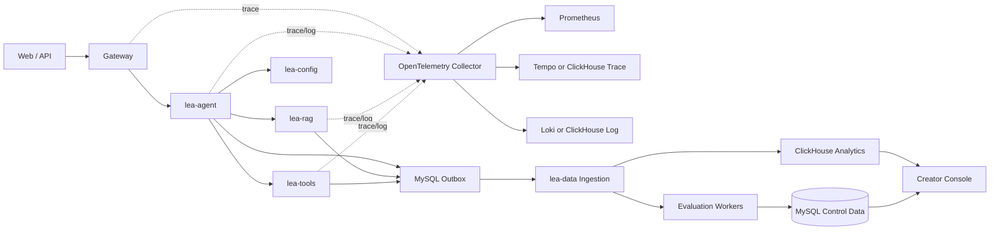

# LEA Agent 可观测、评测与优化平台方案

> 状态：讨论稿 v0.1  
> 范围：Agent/专家执行观测、知识库 RAG 评测、产品埋点、反馈闭环与版本实验  
> 配套原型：`docs/prototypes/agent-observability/index.html`

## 1. 结论

LEA 当前已经具备 Prometheus、Agent Run 状态、工具时间线、专家 Token 用量等基础数据，但数据散落在 Prometheus、控制台日志和 `chat_messages.extra` 中，无法稳定回答创建者最关心的四个问题：

1. 我的 Agent 最近是否变好了？
2. 哪个专家、工具或知识库拖累了效果？
3. 一次失败究竟发生在哪一步？
4. 改 Prompt、模型或检索参数后，收益是否大于成本？

本方案把现有数据统一到 `run → span → signal → evaluation → experiment` 模型中，先形成可观测闭环，再建设自动评测和优化能力。

## 2. 产品目标

### 2.1 目标用户

| 用户 | 主要诉求 |
| --- | --- |
| Agent 创建者 | 观察自己创建的 Agent，定位失败、成本和质量问题 |
| 知识库管理员 | 识别检索盲区、低质量文档、切分和召回问题 |
| 平台管理员/SRE | 观察服务健康、容量、依赖故障和安全事件 |
| 评测运营人员 | 管理数据集、运行回归、审批候选版本 |

### 2.2 成功标准

- 任意线上回答可以通过 `run_id` 还原完整执行链。
- 创建者可以按 Agent、版本、专家、工具、知识库和模型切片指标。
- 每次配置发布前可以运行固定评测集并与当前线上版本对比。
- 线上差评和失败样本可以一键进入评测数据集。
- 优化建议必须给出证据、预计收益和可回滚的候选变更，不直接静默修改线上配置。

### 2.3 非目标

- 第一阶段不建设通用 BI 平台。
- 第一阶段不做无人审批的自动发布。
- 不把完整 Prompt、用户原文或工具密钥写入指标标签。
- 不用 Prometheus 存储高维度的用户级、Run 级分析数据。

## 3. 体验架构

创建者工作台按一个 Agent 的一个版本作为观察上下文，包含五个视图：

| 视图 | 回答的问题 |
| --- | --- |
| 健康概览 | 当前表现如何，主要风险是什么 |
| 执行追踪 | 某一次运行在哪一步慢、错或消耗异常 |
| 专家分析 | 哪个专家贡献高、成本高、经常失败或被绕过 |
| RAG 质量 | 哪类问题检索不到、上下文不准或回答不忠实 |
| 版本实验 | 候选版本是否优于线上版本，能否发布 |

工作台默认展示质量、可靠性、速度、成本四个维度，不用单一总分掩盖问题。

## 4. 统一数据模型

### 4.1 标识链

```text
tenant_id
  └─ user_id
      └─ session_id
          └─ run_id / trace_id
              └─ span_id
                  ├─ agent / expert
                  ├─ llm
                  ├─ tool / mcp / sandbox
                  └─ retrieval / rerank / citation
```

每条事件必须携带：

- `tenant_id`、`session_id`、`run_id`、`trace_id`、`span_id`。
- `agent_id`、`agent_version_id`、`config_snapshot_id`。
- `service`、`environment`、`timestamp`、`event_name`、`schema_version`。
- 可选的 `expert_id`、`tool_name`、`kb_id`、`model_id`。

### 4.2 Run

`agent_runs` 保留事务状态，新增不可变执行快照：

| 字段 | 含义 |
| --- | --- |
| `agent_version_id` | 本次运行使用的 Agent 版本 |
| `config_snapshot_id` | Prompt、模型、技能、工具、知识库和团队拓扑快照 |
| `trace_id` | 跨服务追踪标识 |
| `trigger_type` | user、scheduled、api、evaluation |
| `first_token_at` | 首 Token 时间 |
| `quality_status` | pending、passed、warning、failed、skipped |
| `total_tokens` / `estimated_cost` | 本次完整链路消耗 |

### 4.3 Span

新增分析模型 `agent_run_spans`，一行表示一段可计时、可归因的工作：

| 字段组 | 字段 |
| --- | --- |
| 关系 | `trace_id`、`span_id`、`parent_span_id`、`run_id` |
| 类型 | `span_type`：agent、llm、tool、retrieval、rerank、sandbox |
| 归属 | `agent_id`、`expert_id`、`tool_name`、`kb_id`、`model_id` |
| 状态 | `status`、`error_code`、`retry_count`、`fallback_used` |
| 时间 | `started_at`、`finished_at`、`duration_ms`、`ttft_ms` |
| 用量 | `input_tokens`、`output_tokens`、`cached_tokens`、`cost` |
| 数据 | `input_summary`、`output_summary`、`attributes_json` |

输入输出默认只保存脱敏摘要、Hash 和大小；完整内容按租户策略进入受控对象存储，并设置短保留期。

### 4.4 Retrieval Trace

RAG Span 的 `attributes_json` 至少包含：

- 原始 query、改写 query 的脱敏摘要和 Hash。
- `kb_id`、知识库版本、embedding/reranker 模型。
- 检索模式、top-k、混合权重、过滤条件。
- 候选 chunk、最终 chunk、原始分、rerank 分、文档位置。
- no-hit、低置信、重复结果、被截断上下文等诊断标记。
- 答案引用到的 chunk 与声明之间的映射。

### 4.5 Evaluation

建议新增以下实体：

| 实体 | 用途 |
| --- | --- |
| `eval_datasets` | 数据集元信息、用途、版本和权限 |
| `eval_cases` | 问题、参考答案、参考事实、期望工具和标签 |
| `eval_runs` | 被测 Agent/KB/配置版本、Judge 版本和状态 |
| `eval_results` | 每个 case 的指标、原因、证据和错误类型 |
| `feedback` | 用户评分、原因、修正答案、处理状态 |
| `experiments` | 基线、候选、流量比例、门禁和结论 |

## 5. 数据链路



### 5.1 分层原则

| 数据类型 | 推荐存储 | 原因 |
| --- | --- | --- |
| 服务级指标和告警 | Prometheus | 低维、时序、告警成熟 |
| 分布式 Trace | Tempo 或 ClickHouse | Run/Span 下钻和高维检索 |
| 应用日志 | Loki 或 ClickHouse | 集中检索、保留与脱敏 |
| Agent/专家分析 | ClickHouse | 高维聚合、版本对比、成本分析 |
| 配置、数据集、实验状态 | MySQL | 事务一致性和管理 CRUD |
| 评测附件与大文本 | S3/MinIO | 大对象和生命周期管理 |

MVP 可以先把低流量 Span 写 MySQL，保留 7 天；数据量达到阈值后迁移到 ClickHouse。接口和事件协议从第一天按可迁移设计。

### 5.2 可靠性

- 关键业务事件通过本地事务 Outbox 发出，避免运行完成但分析事件丢失。
- Token 流不进入分析系统，只保留聚合用量和关键阶段。
- Trace 写入失败不得阻塞 Agent 回答。
- 审计事件与普通遥测分开存储，审计不可采样。

## 6. 指标口径

### 6.1 创建者核心指标

| 指标 | 口径 |
| --- | --- |
| 任务成功率 | 完成且无致命错误的 Run / 可判定 Run |
| 用户满意率 | like / 已反馈 Run；同时展示反馈覆盖率 |
| 质量通过率 | 达到评测门槛的被评 Run / 被评 Run |
| 单次成功成本 | 成功 Run 总成本 / 成功 Run 数 |
| P95 总耗时 | 从接收请求到最终结果的 P95 |
| P95 首 Token | 从接收请求到首个可见 Token 的 P95 |

必须同时显示分母、覆盖率和是否估算，避免把“没有采到”显示成 0。

### 6.2 专家指标

- 调用次数、被选中率、完成率、无输出率。
- P50/P95 耗时、输入/输出 Token、峰值上下文。
- 平均迭代轮数、最大轮数耗尽率。
- Handoff 转入、转出、错误转交、兜底到 exit 的比例。
- 工具成功率、检索命中率、失败后的恢复率。
- 质量贡献：包含该专家的 Run 与不包含该专家的匹配样本差异；不直接把最终总分全部归因给最后一个专家。

### 6.3 RAG 指标

离线指标：

- Context Precision、Context Recall、Recall@K、MRR、NDCG。
- Faithfulness、Answer Relevance、Citation Precision、Citation Coverage。
- 答案正确性和参考事实覆盖率。

线上指标：

- no-hit、低分命中、重复 chunk、重排前后提升。
- 引用点击率、引用打开后返回率、用户纠错率。
- 检索 P95、rerank P95、上下文 Token 占比。
- 按知识库、文档、标签、query cluster 和版本切片。

## 7. RAGAS 评测与优化闭环

### 7.1 数据集来源

1. 人工维护的黄金数据集。
2. 线上差评、重试、无命中和高成本样本。
3. 按文档自动生成的问题，必须经过抽样审核后进入回归集。
4. 安全与边界数据集，例如越权、提示词注入、跨租户检索。

### 7.2 运行模式

| 模式 | 场景 | 策略 |
| --- | --- | --- |
| 发布前回归 | Agent/KB/Prompt/模型变更 | 全量固定数据集，作为发布门禁 |
| 定时巡检 | 知识库内容持续更新 | 每日或每周运行代表性样本 |
| 线上 Shadow | 真实流量质量监测 | 1%-5% 异步采样，不影响用户响应 |
| 问题复现 | 单个差评或失败 | 固定运行快照，允许创建候选修复 |

### 7.3 优化流程

```text
发现异常
  → 聚类失败样本
  → 归因到检索 / 生成 / 工具 / 专家 / 数据
  → 生成候选配置
  → 离线回放与成本对比
  → 人工审批
  → 小流量灰度
  → 达标发布或自动回滚
```

候选配置可以调整：chunk size、overlap、top-k、混合检索权重、reranker、query rewrite、Prompt、模型和专家路由。推荐结果必须说明影响范围，不能只给“建议调高 top-k”一类无证据结论。

### 7.4 发布门禁示例

- Faithfulness 不得下降超过 1 个百分点。
- Context Recall 至少提升 3 个百分点，或维持质量同时成本下降 10%。
- P95 总耗时不得恶化超过 15%。
- 安全数据集不得出现新增失败。
- Judge 版本和 Prompt 必须固定并记录，避免评测口径漂移。

## 8. 埋点方案

### 8.1 事件命名

使用 `domain.object.action`：

- `agent.run.started`、`agent.run.completed`、`agent.run.failed`。
- `agent.expert.started`、`agent.expert.handoff`、`agent.expert.completed`。
- `tool.call.completed`、`retrieval.search.completed`。
- `creator.agent.published`、`creator.trace.opened`。
- `feedback.answer.submitted`、`evaluation.run.completed`。

### 8.2 前端事件

第一阶段只采对产品决策有用的事件：

- 创建、编辑、测试、发布、回滚 Agent。
- 打开执行详情、应用筛选、采纳优化建议。
- 创建评测集、启动评测、比较版本、批准实验。
- 用户点赞/点踩及原因，引用打开，重新生成和主动停止。

前端埋点只能记录行为，不作为执行成功的最终事实；成功、失败、Token 和成本以后端事件为准。

## 9. 权限与合规

- 创建者只能查看自己拥有或获授权 Agent 的明细。
- 管理员可以看租户聚合；查看用户原文需要独立审计权限。
- 默认脱敏手机号、邮箱、证件号、密钥、Cookie 和 Authorization。
- 日志、Trace、评测样本分别配置保留期。
- 用户删除数据时同步清理分析索引和对象存储。
- 高基数字段禁止进入 Prometheus label。

## 10. API 草案

```text
GET  /api/creator/agents/{agent_id}/overview
GET  /api/creator/agents/{agent_id}/runs
GET  /api/creator/runs/{run_id}/trace
GET  /api/creator/agents/{agent_id}/experts
GET  /api/creator/agents/{agent_id}/rag-quality

POST /api/creator/eval-datasets
POST /api/creator/eval-runs
GET  /api/creator/eval-runs/{eval_run_id}

POST /api/creator/experiments
POST /api/creator/experiments/{id}/start
POST /api/creator/experiments/{id}/approve
POST /api/creator/experiments/{id}/rollback

POST /api/user/messages/{message_id}/feedback
POST /api/creator/runs/{run_id}/add-to-dataset
```

所有聚合 API 返回 `coverage`、`sample_count`、`estimated` 和 `comparison_window`。

## 11. 分阶段实施

### Phase 0：修正现有监控（1 周）

- 修复 Prometheus Agent 端口、失效告警和熔断阈值。
- 把 RAG、Tools、Config 已定义的业务指标接入真实调用点。
- 修复 LLM/工具耗时为 0 的问题。
- 为所有服务加入统一 `run_id/trace_id` 日志字段和脱敏器。

验收：Prometheus target 全部 UP，告警表达式都有真实数据，单次 Run 可通过日志串联四个服务。

### Phase 1：执行 Trace 与创建者 MVP（2-3 周）

- 建立配置快照和 `agent_run_spans`。
- 从现有 collector 投影工具、专家、LLM、RAG Span。
- 建设健康概览、Run 列表、执行瀑布图和专家分析。
- 接通点赞/点踩及原因。

验收：创建者可以从异常指标下钻到 Run，再定位到专家或工具。

### Phase 2：RAG 评测（2-3 周）

- 引入 RAGAS 适配层，保留自研 Judge 作为补充。
- 建设数据集、评测任务、结果和失败聚类。
- 支持知识库版本与检索参数对比。
- 将线上差评和 no-hit 样本加入待审核数据池。

验收：同一数据集可稳定比较两个版本，结果可复现并记录 Judge 版本。

### Phase 3：实验与发布门禁（2 周）

- Agent、Prompt、团队拓扑和检索配置版本化。
- 建设 A/B、灰度、发布审批和自动回滚。
- 引入质量、成本、延迟多目标门禁。

验收：候选版本必须通过回归和灰度后才能成为默认版本。

### Phase 4：智能优化（持续）

- 失败聚类、根因建议、候选参数搜索。
- 自动生成优化草案，但保留人工审批。
- 基于长期效果校准 Judge 与人工评分的一致性。

## 12. MVP 验收清单

- [ ] 任意 Run 有稳定 `trace_id` 和配置快照。
- [ ] LLM、专家、工具、检索、沙箱均有 Span。
- [ ] 创建者只能查看有权限的 Agent 数据。
- [ ] 概览支持版本和时间范围对比。
- [ ] Run 详情能展示时间瀑布和错误上下文。
- [ ] 专家页展示成功、耗时、Token、迭代和 Handoff。
- [ ] RAG 页展示 no-hit、Faithfulness、Context Recall 和失败样本。
- [ ] 点踩可以填写原因并进入待审核数据池。
- [ ] 评测结果记录数据集、Judge、模型和配置版本。
- [ ] 所有分数展示样本数、覆盖率和估算标记。

## 13. 原型说明

原型重点验证信息架构，不代表最终视觉稿。模拟数据覆盖：

- Agent 与版本切换。
- 时间窗口和环境筛选。
- 健康概览与优化建议。
- Run 搜索、状态筛选与执行详情抽屉。
- 专家效率矩阵与明细。
- RAG 质量指标、失败类型和知识库切片。
- 基线/候选版本实验对比和发布门禁。

